# Jasmin SMS Gateway - Docker & Production Helm Chart

Comprehensive production deployment package for **Jasmin SMS Gateway** on Kubernetes, including an optimized container image, live-tested jCLI authentication, and a fully tested Helm Chart with Gateway API `HTTPRoute` support.

> [!NOTE]
> **Disclaimer:**
> This repository provides an **unofficial**, hardened community distribution of Jasmin SMS Gateway, including custom Wolfi Linux container images, automated SLSA Level 3 attestations, and a Web Management Dashboard. This distribution is independently maintained and is not officially affiliated with, sponsored by, or endorsed by Jookies or the official Jasmin SMS Gateway project.
> * Official Jasmin SMS Gateway: [https://www.jasminsms.com](https://www.jasminsms.com) / [jookies/jasmin](https://github.com/jookies/jasmin).

---

## 1. Jasmin Architecture & Component Breakdown

Jasmin is an open-source, enterprise-grade SMS Gateway written in Python on top of the **Twisted** event-driven network engine.

### Core Daemons & Services:
* **`jasmind.py` (Core Gateway Daemon):**
  - **SMPP Server (Port 2775):** Listens for inbound SMPP client connections (ESME) for message submission (MT) and delivery (MO).
  - **HTTP API (Port 1401):** HTTP endpoint for sending SMS and querying Prometheus metrics (`/metrics`).
  - **jCLI Console (Port 8990):** Telnet-based interactive CLI for real-time management (users, groups, filters, connectors, routes) without restarting services.
  - **Perspective Broker (PB) Ports:** Internal RPC ports for connector management (`8989`), router (`8988`), and SMPP server (`14000`).
* **`interceptord.py` (Message Interceptor Daemon - Port 8987):**
  - Intercepts messages before the routing engine to apply custom Python logic (real-time billing, HLR lookups, PDU modification).
* **Delivery & Lookup Workers (Horizontally Scalable):**
  - `dlrd.py`: Dedicated daemon for dispatching Delivery Receipts (DLR) to clients.
  - `dlrlookupd.py`: Daemon for tracking DLR statuses via Redis.
  - `deliversmd.py`: Daemon for delivering incoming Mobile Originated (MO) messages.
* **Underlying Infrastructure Dependencies:**
  - **RabbitMQ (AMQP Broker - Port 5672):** High-reliability Store-and-Forward message queuing.
  - **Redis (Port 6379):** High-speed in-memory store for DLR mapping and user billing/credit quotas.

---

## 2. Dockerfile & Critical Bug Fixes

While an official Dockerfile exists in upstream `jookies/jasmin`, it crashes when deployed to modern environments. Our Dockerfile fixes three critical upstream bugs:

1. **Python 3.12 `pkg_resources` Removal:**
   - Jasmin imports `from pkg_resources import iter_entry_points`. In `setuptools>=82`, `pkg_resources` was removed. We pin `setuptools<82` to resolve this.
2. **Missing AMQP Specification XML Files:**
   - Jasmin's `txamqp` library expects specification files (`amqp0-9-1.xml` and `amqp0-8.stripped.rabbitmq.xml`) at `/etc/jasmin/resource/`. Without them, AMQP initialization crashes. These are now bundled in the image.
3. **jCLI admin password: plain text in, PBKDF2 inside (no MD5):**
   - `JCLI_ADMIN_PASSWORD` is always the plain-text password. Nothing guesses whether it is "already a hash" (a random 32-character hex password such as `openssl rand -hex 16` used to be mistaken for an MD5 digest, and login failed).
   - Upstream Jasmin stores this password as an unsalted MD5 and compares `md5(password)`. The image patches jCLI (`docker/patches/`) to verify a salted **PBKDF2-SHA256** hash instead; the entrypoint hashes the plain password at start-up. The patch fails the build if the upstream code does not match exactly.
   - Passwords jasmind could never accept stop the container with a clear message: non-ASCII characters (`jasmind -p` encodes ASCII), leading/trailing spaces (jCLI strips them), control characters.
   - Still MD5, by Jasmin's design: the passwords of Jasmin *users* (SMPP/HTTP clients) inside the store, and the internal PB services (Twisted PB, `127.0.0.1` only). Changing those would break existing stores.
4. **Interface Binding:**
   - Automatically defaults `jcli`, `smpp-server`, and `http-api` to bind to `0.0.0.0` instead of `127.0.0.1` so that Kubernetes services can route traffic to them.
5. **Memory Optimization:**
   - Preloads `libjemalloc2` (`LD_PRELOAD=/usr/lib/x86_64-linux-gnu/libjemalloc.so.2`) to prevent memory fragmentation under high load.
6. **Delivery receipts broken in Jasmin 0.11.x (`submit_sm_resp`):**
   - In the released code, `submit_sm_resp_event()` reads `_pdu.response`, but for single-part messages `_pdu` is the `SubmitSM` request, which has no `.response`. Every `ESME_ROK` response raises `AttributeError`, so the DLR is never handed to DLRLookup, `submit_sm_resp` billing is skipped and `submit.sm.resp.*` is never published. The image backports the upstream fix (jookies/jasmin `master`, not in any release yet), and the build only patches when the buggy code is present.
7. **Read-only `jasmin.cfg` (Kubernetes ConfigMap):**
   - `configure.py` used to rewrite `/etc/jasmin/jasmin.cfg` in place, which crashes on a read-only ConfigMap mount. When the file is read-only, the entrypoint now writes the merged configuration to `/tmp/jasmin-runtime/jasmin.cfg` and starts `jasmind -c <copy>`.
8. **`publish_submit_sm_resp`:**
   - Configurable through `SM_LISTENER_PUBLISH_SUBMIT_SM_RESP` (and `config.smListener.publishSubmitSmResp` in Helm, default `true`) so carrier responses are published for the console's live traffic view.
9. **Environment files (Vault Agent) without overriding the command:**
   - `JASMIN_ENV_FILES=/vault/secrets/config[:...]` (Helm: `envFiles`) is sourced by both images before start-up. `REDIS_*` and `RABBITMQ_*` names are mapped onto Jasmin's variables, but only when the files set them, so the `REDIS_PORT=tcp://...` variables Kubernetes injects are ignored. A missing file stops the container. Overriding the command instead easily drops `--enable-dlr-lookup --enable-dlr-thrower --enable-interceptor-client`, which silently disables delivery receipts and interceptors.
10. **Logs to stdout:**
   - `JASMIN_LOG_TO_STDOUT=true` (Helm: `config.logToStdout`) sets every component's `<SECTION>_LOG_FILE=/dev/stdout`; Jasmin switches to a stream handler for any log file containing `stdout`. No log volume to clean up; Fluent Bit / Promtail collect it.

---

## 3. Helm Chart Structure & Features

```
helm/jasmin/
├── Chart.yaml
├── values.yaml
├── .helmignore
└── templates/
    ├── _helpers.tpl
    ├── statefulset.yaml      # StatefulSet with persistent storage for /etc/jasmin/store
    ├── service.yaml          # Exposes SMPP (2775), HTTP API (1401), jCLI (8990)
    ├── configmap.yaml        # Structured jasmin.cfg and interceptor.cfg templates
    ├── secret.yaml           # Passwords for jCLI, RabbitMQ, and Redis
    ├── ingress.yaml          # Standard Kubernetes Ingress
    ├── httproute.yaml        # Kubernetes Gateway API HTTPRoute (gateway.networking.k8s.io/v1)
    ├── servicemonitor.yaml   # Prometheus Operator ServiceMonitor
    └── NOTES.txt             # Post-install connection commands
```

### Full Configuration Control from `values.yaml`:
All sections of `jasmin.cfg` are now directly configurable via structured blocks in `values.yaml`:
* `config.smppServer.*` (bind, port, billingFeature, dlrExpiry, timers)
* `config.jcli.*` (bind, port, authentication, adminUsername, adminPassword)
* `config.httpApi.*` (bind, port, showJasminVersion)
* `config.redisClient.*` (poolsize, dbid)
* `config.amqpBroker.*` (vhost)
* `config.dlr.*` and `config.deliversmThrower.*`
* `config.extraConfig` (raw INI lines for any custom directives)
* `httpRoute` (Kubernetes Gateway API HTTPRoute support for exposing Jasmin HTTP API)
* `jasminRoutes` (Automated provisioning of HTTP Client Connectors and MO/MT routes)
* `hostNetwork` & `dnsPolicy` (ClusterFirstWithHostNet)
* `extraEnv`, `extraEnvFrom`, `extraVolumes`, `extraVolumeMounts`

---

## 4. Client Networking Architecture: Do you need `hostNetwork`?

**Short Answer:** **NO.** In 99% of production Kubernetes deployments, you do **NOT** need `hostNetwork: true`.

### How Clients Connect:
1. **SMPP Clients (ESME - Port 2775):**
   * SMPP is a persistent TCP connection.
   * **Recommended Approach:** Use Kubernetes `Service` with `type: LoadBalancer` (e.g. AWS NLB, GCP Network Load Balancer, MetalLB, Kube-VIP) and set `externalTrafficPolicy: Local`.
   * **Preserving Client Source IP:** Setting `externalTrafficPolicy: Local` prevents `kube-proxy` SNAT, ensuring Jasmin receives the original client IP (critical for Jasmin firewall and IP-based authentication).
   * **Alternative (NodePort):** Set `service.type: NodePort` and point clients or upstream firewalls to `<Node-IP>:<NodePort>`.
2. **HTTP Clients (Port 1401):**
   * Connect via Kubernetes Gateway API `HTTPRoute`, Standard Ingress, or the same `LoadBalancer` Service.
3. **Admin CLI (jCLI - Port 8990):**
   * Kept private inside the cluster. Accessible via `kubectl port-forward` or internal VPN.

### When to use `hostNetwork: true`?
* Only in bare-metal Kubernetes environments with **no LoadBalancer controller** (no MetalLB) where you want port 2775 bound directly to the host's physical network adapter.
* **Caveat:** `hostNetwork: true` binds host ports directly (meaning only 1 Jasmin instance per node) and bypasses CNI network policies. Our chart safely sets `dnsPolicy: ClusterFirstWithHostNet` when `hostNetwork: true` is enabled so internal CoreDNS resolution is never broken.

---

## 5. How to Pass & Patch Configurations via Helm

You can configure Jasmin through 5 distinct methods depending on your needs:

1. **Structured Values (`config.*` in `values.yaml`):**
   ```yaml
   config:
     smppServer:
       port: 2775
       dlrExpiry: 86400
     redisClient:
       poolsize: 50
   ```
2. **Raw INI Directives (`config.extraConfig`):**
   ```yaml
   config:
     extraConfig: |
       [my-custom-section]
       enable_custom_flag = True
   ```
3. **Full INI Override (`config.customJasminCfg` / `config.customInterceptorCfg`):**
   Directly injects the entire `jasmin.cfg` file content.
4. **Environment Variables (`extraEnv` / `extraEnvFrom`):**
   ```yaml
   extraEnv:
     - name: LOG_LEVEL
       value: "DEBUG"
   ```
5. **Custom Files & Scripts (`extraVolumes` / `extraVolumeMounts`):**
   Mount custom interceptor scripts or certificates directly into the pod.

---

## 6. HTTP Route Implementation: Two Dimensions

### A. Kubernetes Gateway API HTTPRoute (`gateway.networking.k8s.io/v1`)
Exposes Jasmin's HTTP API (port 1401) to external traffic with fine-grained endpoint control:
* **Predefined Endpoint Presets:**
  * `/send`: Submit SMS (GET / POST)
  * `/rate`: Calculate SMS billing rate (GET)
  * `/balance`: Query user balance (GET)
  * `/ping`: Health check (GET)
  * `/metrics`: Prometheus metrics (can be toggled or kept private)
* **Custom Rules:** Full support for custom headers, query params, path prefix / exact matches, timeouts, and filters.

Example `values.yaml` snippet:
```yaml
httpRoute:
  enabled: true
  parentRefs:
    - name: "my-gateway"
      namespace: "default"
      sectionName: "http"
  hostnames:
    - "sms.example.com"
  endpoints:
    send:
      enabled: true
      path: /send
      methods: [GET, POST]
    ping:
      enabled: true
      path: /ping
      methods: [GET]
```

### B. Jasmin SMS HTTP Routes & Connectors (`jasminRoutes`)
Enables Jasmin to route inbound SMS (MO) to external HTTP webhooks or APIs without manual Telnet commands:
* Automatically provisions `httpccm` (HTTP Client Connectors) and `morouter` (MO Routes) on container startup via `bootstrap-routes.py`.
* Persists routes directly into `/etc/jasmin/store` and reloads them on container restarts.

Example `values.yaml` snippet:
```yaml
jasminRoutes:
  enabled: true
  httpConnectors:
    - cid: "webhook_prod"
      url: "http://webhook-service.default.svc.cluster.local:8080/sms/incoming"
      method: "POST"
  moRoutes:
    - type: "DefaultRoute"
      connector: "http(webhook_prod)"
```

---

## 7. Production Telecom Resilience, Autoscaling & Kernel Tuning

High-throughput telecom workloads demand zero-downtime resilience for persistent, stateful SMPP client/server sessions. The Helm chart incorporates dedicated controls for kernel tuning, autoscaling, and zero-downtime rolling updates:

### A. Kernel Network Stack Tuning (`sysctls`)
Telecom SMS gateways handle bursts of thousands of concurrent TCP connections. Tuning the Linux kernel network stack buffers and socket queues prevents packet drops and connection throttling during peak loads:
```yaml
sysctls:
  enabled: true
  # Safe sysctls (namespaced, supported in Kubernetes 1.29+ / 1.32+ without kubelet flags)
  safe:
    enabled: true
    values:
      net.ipv4.tcp_syncookies: "1"               # Protect against SYN flood attacks
      net.ipv4.ip_local_port_range: "1024 65535" # Expand ephemeral port range for outbound binds
      net.ipv4.tcp_fin_timeout: "30"             # Accelerate cleanup of closed sockets
      net.ipv4.tcp_rmem: "4096 131072 6291456"   # TCP read buffers (min, default, max)
      net.ipv4.tcp_wmem: "4096 65536 6291456"    # TCP write buffers (min, default, max)
      net.ipv4.tcp_keepalive_time: "60"          # Send keepalive probe after 60s idle
      net.ipv4.tcp_keepalive_intvl: "10"         # Probe interval
      net.ipv4.tcp_keepalive_probes: "6"         # Drop stale dead connections after 6 probes
  # Unsafe sysctls (require --allowed-unsafe-sysctls on kubelet)
  unsafe:
    enabled: false
    values:
      net.core.somaxconn: "4096"                 # Expand listen socket backlog
      net.ipv4.tcp_max_syn_backlog: "4096"       # Expand SYN queue backlog
```

### B. StatefulSet Update Strategy (`updateStrategy`)
By default, Kubernetes `RollingUpdate` restarts pods immediately upon any template or configuration change. For stateful SMPP gateways, an unexpected pod restart severes all active upstream carrier binds and downstream customer sessions:
```yaml
updateStrategy:
  type: OnDelete # Only restarts pods when manually deleted, allowing maintenance during quiet hours
  # Or use partition:
  # type: RollingUpdate
  # rollingUpdate:
  #   partition: 1 # Prevents automatic pod restart on template change
```

### C. Kubernetes 1.33+ In-Place Pod Resource Resizing (`resizePolicy`)
Allows scaling CPU and Memory requests/limits dynamically on-the-fly without restarting the container:
```yaml
resizePolicy:
  - resourceName: cpu
    restartPolicy: NotRequired
  - resourceName: memory
    restartPolicy: NotRequired
```
With `restartPolicy: NotRequired`, expanding memory to handle sudden DLR spikes or traffic rushes will never trigger an `OOMKilled` restart or drop active SMPP sessions.

### D. Vertical Pod Autoscaler Integration (`autoscaling.vpa`)
Jasmin's Twisted event loop runs on a single thread bounded by Python's Global Interpreter Lock (GIL). Over-allocating CPU to a single process cannot exceed 1 core. The native VPA integration tracks actual resource consumption and provides advisory recommendations:
```yaml
autoscaling:
  vpa:
    enabled: true
    updateMode: "Off" # Recommendations-only mode (safest for SMPP production)
    controlledResources:
      - cpu
      - memory
    minAllowed:
      cpu: 250m
      memory: 512Mi
    maxAllowed:
      cpu: 2000m
      memory: 8Gi
```

### E. Telecom Alerting Pack (`monitoring.prometheusRule`)
Pre-packaged Prometheus Operator alerting rules monitoring Jasmin core telemetry:
```yaml
monitoring:
  serviceMonitor:
    enabled: true
    interval: 30s
    path: /metrics
  prometheusRule:
    enabled: true
    rules:
      smppConnectorDown:
        severity: critical
        for: 1m
      highSubmitErrorRate:
        severity: warning
        threshold: "0.05"
        for: 2m
      reactorHighCPU:
        severity: warning
        for: 5m
```
* **`JasminSMPPConnectorDown`**: Critical alert when upstream carrier SMPP session bound count reaches 0.
* **`JasminHighSubmitErrorRate`**: Warning when MT message submit error rate exceeds 5%.
* **`JasminReactorHighCPU`**: Warning when single-core CPU utilization exceeds 90% for >5m, signaling the need for horizontal pod scaling.

---

## 8. Verification Proof

- **End-to-end test (2026-11-04)** against the image built from `docker/Dockerfile` (Jasmin 0.11.1) with Redis and RabbitMQ, and the console container in the same pod:
  - jCLI output parsed from real responses; users, groups, connectors, filters, MT/MO routes created through the console and verified with `jcli` in a new session.
  - Real SMS through the HTTP API: `SUBMITTED` → `ESME_ROK` with latency in the live view; after the `submit_sm_resp` backport `dlr.submit_sm_resp` is published and no `AttributeError` is logged.
  - Flow editor: wiring, validation, deploy review, deploy, and a message routed by the newly deployed route.
  - Single sign-on with a local OpenID Connect provider: pending → approved → role change → disabled; role mapping from the `roles` claim; RP-initiated logout.
  - The chart rendered with `helm template` and run with `podman kube play`: Jasmin starts with the read-only ConfigMap, the console signs in with the Secret-provided admin and keeps its data on the store volume.


- **Live jCLI Login & Route Provisioning Test:**
  Ran a live test stack with `redis`, `rabbitmq`, and `jasmin:local`. Verified automated bootstrap and Telnet console:
  ```
  [INFO] [bootstrap] Waiting for jCLI at 127.0.0.1:8990...
  [INFO] [bootstrap] jCLI is reachable at 127.0.0.1:8990 on attempt 7.
  [INFO] [bootstrap] Successfully authenticated to jCLI.
  [INFO] [bootstrap] Executed 'load' to restore persisted configuration.
  [INFO] [bootstrap] Provisioning HttpConnector 'auto_http_01' (POST -> http://sms-webhook.default.svc.cluster.local:8080/incoming-sms)...
  [INFO] [bootstrap] HttpConnector 'auto_http_01' created successfully.
  [INFO] [bootstrap] Provisioning MO Route (DefaultRoute -> http(auto_http_01))...
  [INFO] [bootstrap] MO Route (DefaultRoute -> http(auto_http_01)) created successfully.
  [INFO] [bootstrap] Persisted all new configurations to store.
  [INFO] [bootstrap] Bootstrap process completed successfully.
  ```
- **Live HTTP API Verification:**
  - `GET /` -> Status `200` (`0.11.1`)
  - `GET /ping` -> Status `200` (`Jasmin/PONG`)
- **Helm Lint:** Passed with 0 errors (`1 chart(s) linted, 0 chart(s) failed`).
- **Helm Template:** Verified rendering of both Kubernetes `HTTPRoute` (`gateway.networking.k8s.io/v1`) and ConfigMap `routes.json`.
- **Helm Template Rendering:** Tested with default values, `httpRoute.enabled=true`, `config.smppServer.dlrExpiry=99999`, and `config.redisClient.poolsize=50`.

---

## 9. Jasmin Console (`gui/`)

A web console for Jasmin, running as a sidecar next to `jasmind`. It talks to the real gateway through jCLI (`127.0.0.1:8990`), the HTTP API (`:1401`) and a read-only tap on RabbitMQ. It ships no demo data: everything on screen comes from the gateway.

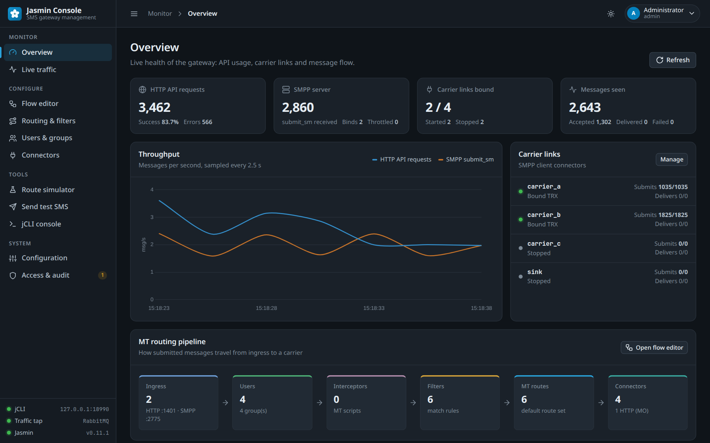

### What it does
* **Overview:** HTTP API and SMPP server counters, carrier link health, live throughput and the MT routing pipeline at a glance.
* **Live traffic:** every MT message from RabbitMQ (`submit.sm.*`, `submit.sm.resp.*`, `dlr_thrower.*`) with carrier acceptance, latency, decoded PDU, search, status filters and CSV export. Pickles are decoded safely (no code execution), including UCS-2 / Arabic content.
* **Flow editor:** a node-based editor for MT routing: drag filters, routes and connectors from the palette, wire them, double-click to edit. Rules from Jasmin are checked while you edit (order 0 is the default route, Static routes have one connector, routes need filters, MT routes only use `smppc(...)`). **Deploy** shows the exact jCLI changes first, then applies them in one session and persists. Loading a flow and deploying it unchanged makes zero changes. Live messages animate along the wires into the connector that carried them.
* **Routing & filters:** MT/MO routes and filters as tables; create and delete with the same validation.
* **Users & groups, Connectors:** create, edit quotas and balance, start/stop carrier links, with guards for operations jCLI would silently get wrong (re-using a UID overwrites the user; deleting a connector still used by routes).
* **Route simulator:** shows which route and connector Jasmin would pick for a message and why, filter by filter (regex filters are anchored like Python `re.match`).
* **Send test SMS:** submits through the HTTP API and follows the message live.
* **jCLI console:** a full terminal (xterm.js, JetBrains Mono Nerd Font) with a command reference, session info, copy, font size and fullscreen. Commands are written to the audit log with passwords masked.
* **Access & audit:** sign-in, roles, approval of new single sign-on users and an audit log of sign-ins, account changes, gateway changes and console commands.

| | |
|---|---|
| 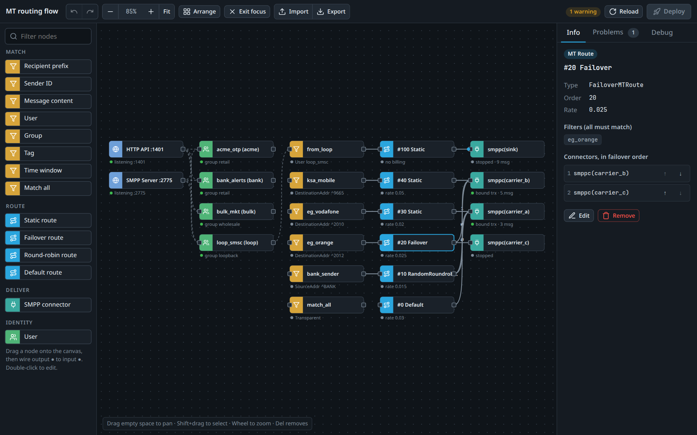 | 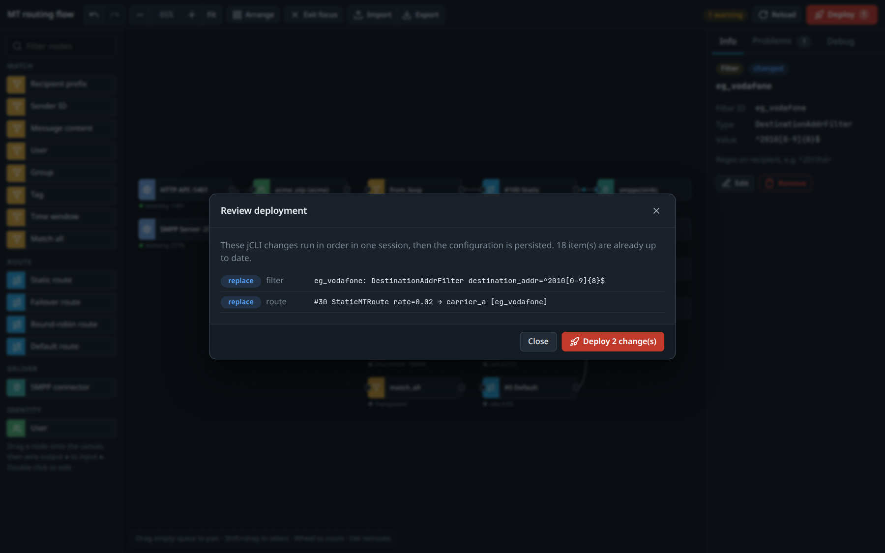 |
| 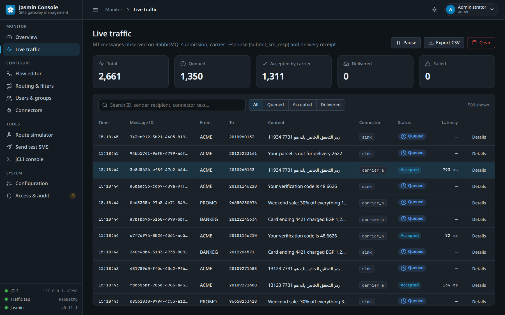 | 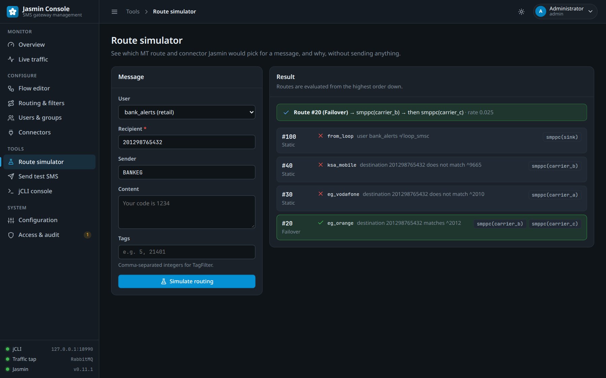 |
| 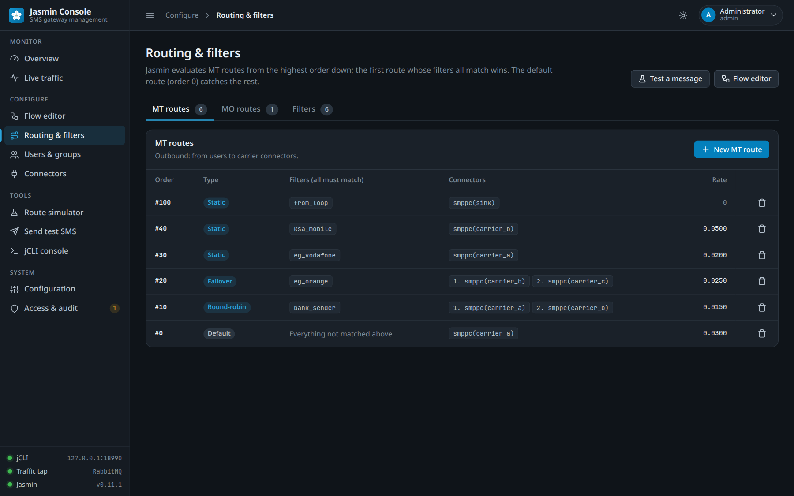 | 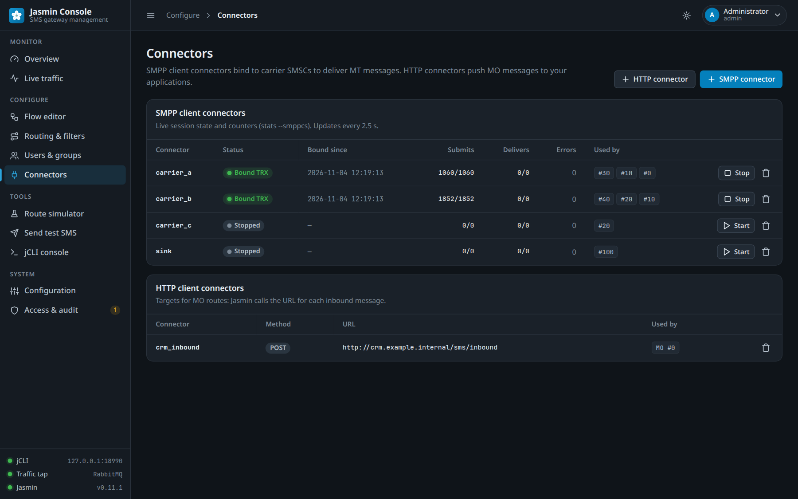 |
| 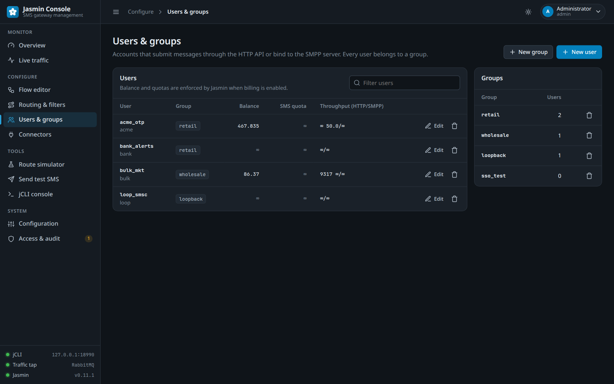 | 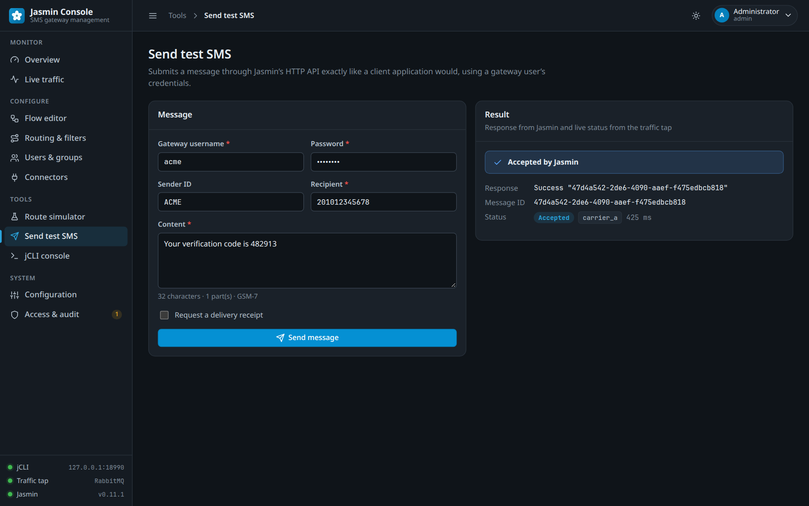 |
| 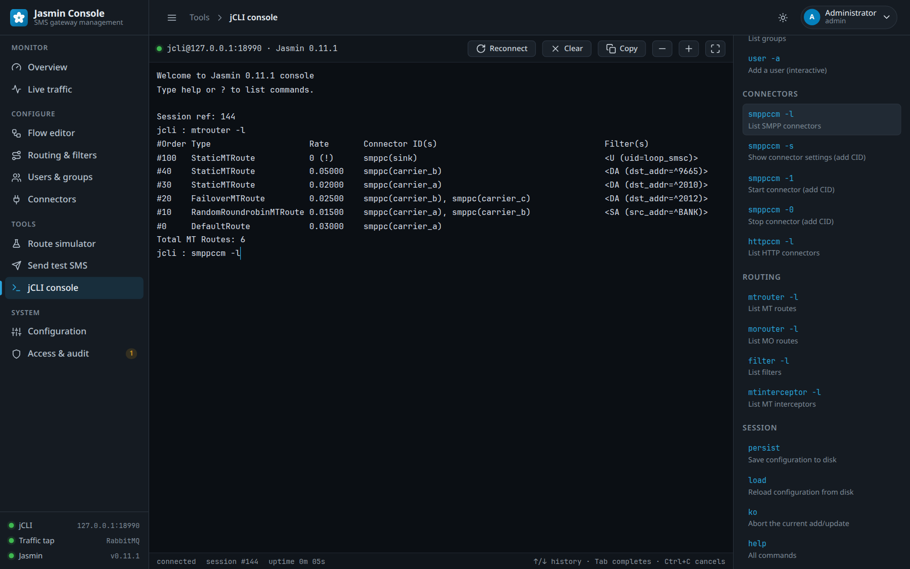 | 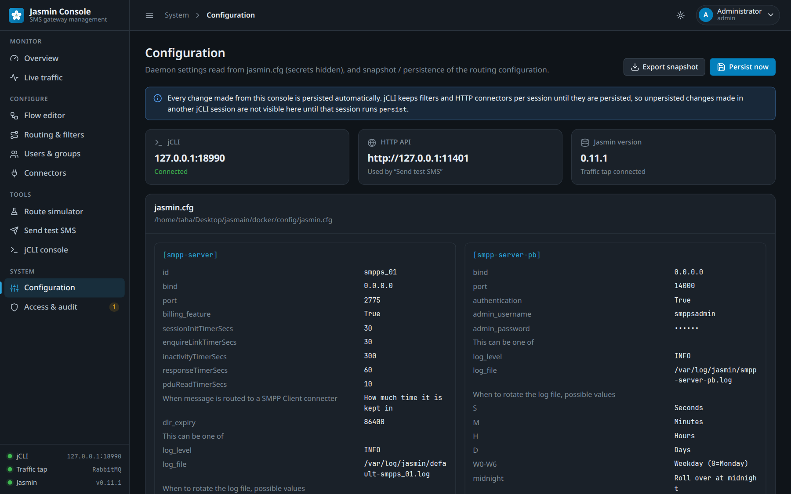 |
| 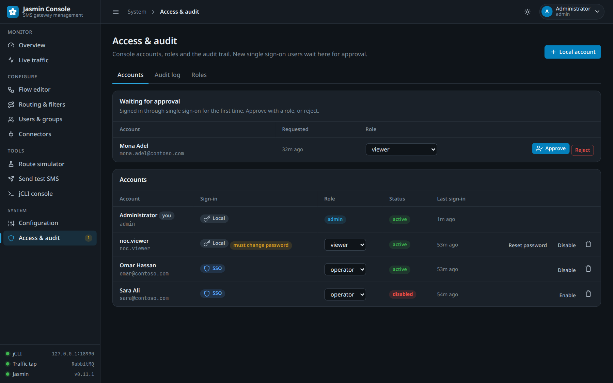 | 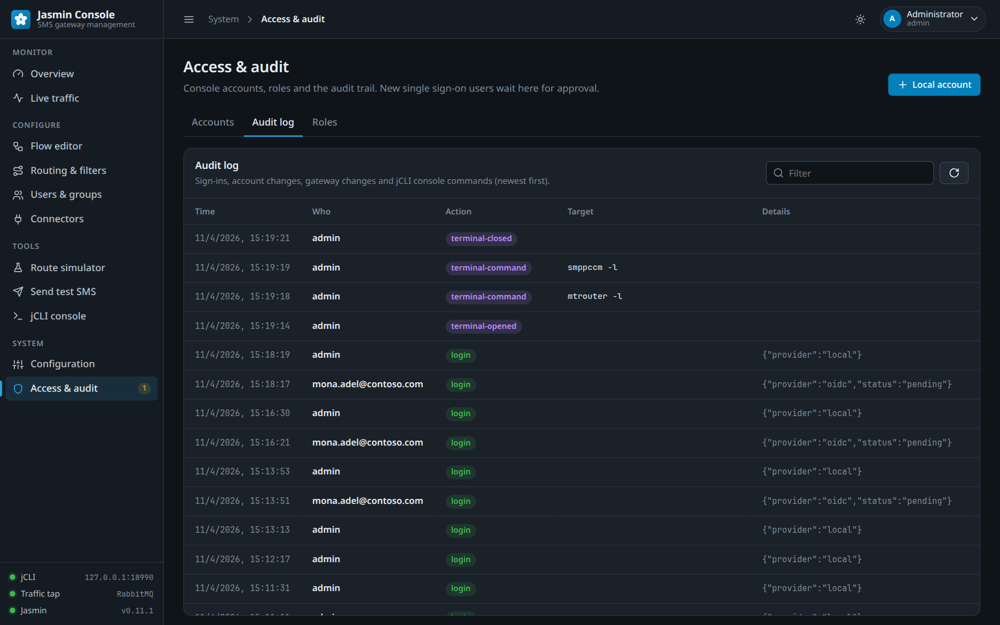 |
| 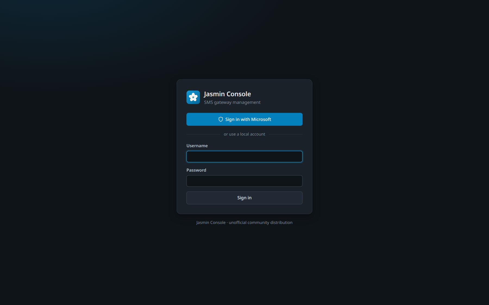 |  |
|  | 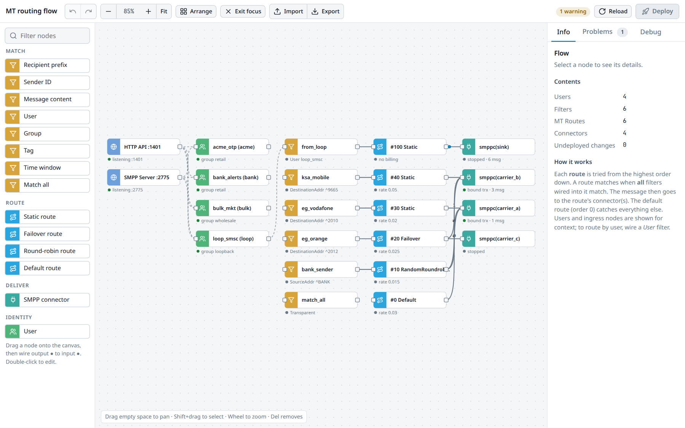 |

### Sign-in and roles
* **Initial administrator:** created on first start when no active admin exists, from `ADMIN_USERNAME` / `ADMIN_PASSWORD`. Without a password one is generated and printed once in the log, and must be changed at first sign-in.
* **Single sign-on (OpenID Connect):** Authorization Code flow with PKCE, `state` and `nonce`. A user signing in for the first time is **pending** until an administrator approves the account with a role. Alternatively, roles can come from the token (`OIDC_ROLE_MAP`, e.g. Entra ID app roles).
* **Roles:**

| Role | Can |
|---|---|
| `admin` | everything, including console accounts and the audit log |
| `operator` | change gateway configuration, deploy flows, jCLI console, send test SMS |
| `viewer` | read-only monitoring; message content is masked |

* **Session security:** HttpOnly SameSite cookies, CSRF header and Origin checks on every change and WebSocket, scrypt password hashes, login rate limiting, sessions revoked on disable or password change.

### Microsoft Entra ID setup
1. Entra admin center → **App registrations** → **New registration**. Redirect URI (Web): `https://<console-host>/auth/oidc/callback`.
2. **Certificates & secrets** → new client secret.
3. Optional, to skip manual approval: **App roles** → create `Jasmin.Admin`, `Jasmin.Operator`, `Jasmin.Viewer`, then assign users or groups in **Enterprise applications**.
4. Helm values:
```yaml
dashboard:
  ingress:                             # or dashboard.httpRoute (Gateway API)
    enabled: true
    className: nginx
    host: jasmin-console.example.com   # the console needs its own hostname
    tls:
      - secretName: jasmin-console-tls
        hosts: [jasmin-console.example.com]
    annotations:
      nginx.ingress.kubernetes.io/proxy-read-timeout: "3600"   # WebSockets
  # publicUrl and trustProxy are derived from the ingress host; set them only to override.
  admin:
    existingSecret: jasmin-console     # key: dashboard-admin-password (break-glass account)
  oidc:
    enabled: true
    issuerUrl: https://login.microsoftonline.com/<tenant-id>/v2.0
    clientId: <application-client-id>
    existingSecret: jasmin-console     # key: oidc-client-secret
    displayName: Microsoft
    roleMap: "admin=Jasmin.Admin,operator=Jasmin.Operator,viewer=Jasmin.Viewer"   # or "" for manual approval
```

### Kubernetes notes
* The pod runs under its own ServiceAccount with `automountServiceAccountToken: false`. Neither Jasmin nor the console calls the Kubernetes API, so the chart creates no Role or RoleBinding.
* **Administrative ports stay private.** With `service.type: LoadBalancer` or `NodePort`, the public Service carries only SMPP (2775) and the HTTP API (1401). jCLI (8990, a plaintext admin console) and the console (3000) are reachable in-cluster through the `<release>-jasmin-admin` ClusterIP Service, or publicly only if you set `service.exposeAdminPorts: true`. With the default `ClusterIP` nothing changes.
* The PB services used only inside the pod (router 8988, client manager 8989, SMPP server PB 14000, interceptor 8987) listen on `127.0.0.1`. The interceptor configuration is written to the `[interceptor]` section that `interceptord` actually reads (earlier versions wrote `[interceptor-pb]`, which was ignored).
* `credentials.jcli.password` empty (default): a random password is generated and kept across `helm upgrade`. Set it, or `existingSecret`, when rendering without cluster access (Argo CD, Flux).
* The image passes the configured jCLI credentials to `jasmind` (instead of the defaults in the image `CMD`), so it reloads the persisted configuration itself on start-up.
* Prometheus alerts use the metrics Jasmin 0.11.1 actually exports (`smppc_*{cid}`, `httpapi_*`, `smppsapi_*`); they were verified in Prometheus against a running gateway (a down connector fires, a bound one does not).
* Redis and RabbitMQ are not bundled: `redis.enabled` / `rabbitmq.enabled` must stay `false`; set `externalRedis` / `externalRabbitMQ`.
* Console accounts, sessions and the audit log are stored in `console/` on the `store` volume, so they survive pod restarts together with Jasmin's configuration. Sessions are stored with hashed ids; a restart does not sign anyone out (`dashboard.session.persist`).
* **Audit lifecycle** (`dashboard.audit`): the trail is rotated daily and at `maxFileMB`, files older than `retentionDays` (default 180) are deleted, and the oldest go first above `maxTotalMB`. Admins can filter it and download it as CSV or JSON lines; `stdout: true` also streams it to the container log for a SIEM.
* **Flow deploys are checked against the review:** the plan the user approved has a fingerprint; if the gateway changed in between (another admin, the jCLI terminal, a stale tab) the deploy is refused and the updated plan is shown. jCLI's own rules (filter IDs ≤16 characters, connector IDs 3-25, MO-only filters, connector counts per route type, interval formats) are checked before anything runs.
* **Vault / External Secrets:** `envFiles: ["/vault/secrets/config"]`, `credentials.createSecret: false`, `credentials.useSecretRef: false`. No command override is needed. `extraObjects` deploys extra manifests (e.g. a NetBird `SetupKey`) without forking the chart; `extraInitContainers`, `extraContainers`, `command`/`args` are available for the rest.
* `enableServiceLinks: false` by default: Jasmin reads any `<SECTION>_<OPTION>` environment variable as configuration, and Service link variables could collide with it.

### Managing the volumes (PVCs)
| Claim | Mounted at | Holds | Size value |
|---|---|---|---|
| `store-<release>-jasmin-0` | `/etc/jasmin/store` (Jasmin), `/data` (console) | `persist`ed users, groups, connectors, filters, routes; console accounts, sessions, audit trail | `persistence.size` |
| `logs-<release>-jasmin-0` | `/var/log/jasmin` | Jasmin log files (per pod hostname) | `persistence.logsSize` |

* **Logs:** prefer `config.logToStdout: true` with `persistence.logsEnabled: false`; logs then go to the container log and `/var/log/jasmin` becomes an `emptyDir` limited to `logsSize`. No log-cleaner sidecar is needed.
* **Growing a volume:** StatefulSet PVC templates cannot change after install. When Helm can read the cluster, the chart stops an upgrade that would change them and prints the procedure: patch the PVC itself (`allowVolumeExpansion: true` on the StorageClass), then `kubectl delete statefulset <name> --cascade=orphan` (the pod and PVCs keep running) and upgrade/sync again. Argo CD renders without cluster access, so do the same steps there before syncing a size change.
* **Retention:** `persistence.retentionPolicy: {whenDeleted: Retain, whenScaled: Retain}` keeps PVCs when the release is uninstalled or scaled down (Kubernetes ≥1.27). Deleting the namespace still deletes them.
* **Restore / migrate:** `persistence.existingClaim` mounts an existing PVC (e.g. restored from a VolumeSnapshot) as the store. The console's *Export* (JSON snapshot of the gateway configuration) is a light backup that does not depend on the volume.
* One store per pod: replicas do not share configuration. Keep `replicaCount: 1` unless you replicate changes yourself.

### Configuration (environment)
| Variable | Default | Purpose |
|---|---|---|
| `PORT` | `3000` | HTTP port |
| `JCLI_HOST` / `JCLI_PORT` / `JCLI_ADMIN_USERNAME` / `JCLI_ADMIN_PASSWORD` | `127.0.0.1` / `8990` / `jcliadmin` | jCLI access |
| `HTTP_API_URL` | `http://127.0.0.1:1401` | Jasmin HTTP API (test SMS) |
| `RABBITMQ_HOST` / `_PORT` / `_USER` / `_PASS` / `_VHOST` | from `jasmin.cfg` | traffic tap |
| `DATA_DIR` | `./data` (`/data` in the image) | console accounts and audit log |
| `ADMIN_USERNAME` / `ADMIN_PASSWORD` | `admin` / generated | initial administrator |
| `PUBLIC_URL`, `TRUST_PROXY` | | external URL (OIDC redirect), reverse proxy |
| `SESSION_IDLE_MINUTES` / `SESSION_MAX_HOURS` | `60` / `12` | session lifetime |
| `SESSION_PERSIST` | `true` | keep sessions across restarts (`DATA_DIR/sessions.json`, hashed ids) |
| `AUDIT_RETENTION_DAYS` / `AUDIT_MAX_FILE_MB` / `AUDIT_MAX_TOTAL_MB` / `AUDIT_STDOUT` | `180` / `20` / `500` / `false` | audit trail lifecycle |
| `JASMIN_ENV_FILES` | | shell env files sourced at start (e.g. Vault Agent); `RABBITMQ_PASSWORD`, `DASHBOARD_ADMIN_USERNAME/PASSWORD` are mapped |
| `JASMIN_LOG_TO_STDOUT` | `false` | new SMPP connectors log to stdout (`logfile /dev/stdout`) |
| `OIDC_ISSUER_URL`, `OIDC_CLIENT_ID`, `OIDC_CLIENT_SECRET`, `OIDC_DISPLAY_NAME`, `OIDC_SCOPES`, `OIDC_ROLE_CLAIM`, `OIDC_ROLE_MAP` | | single sign-on |

### Running locally
```bash
cd gui
npm ci
ADMIN_PASSWORD='choose-a-strong-one' JCLI_PORT=8990 npm run dev   # http://localhost:3000
npm test        # 77 tests, including replays of real Jasmin 0.11.1 jCLI output and AMQP pickles
```

### Notes on Jasmin behaviour the console relies on
* jCLI keeps filters and HTTP connectors **per session** until `persist`. The console therefore makes every change in a fresh session followed by `persist`, and reads through a session that is recycled regularly. Changes made in another jCLI session appear here once that session persists them.
* MT routes keep their own copy of each filter. Editing a filter in the flow editor re-saves every route that uses it.
* Saving an MT route with an existing order replaces it atomically.
